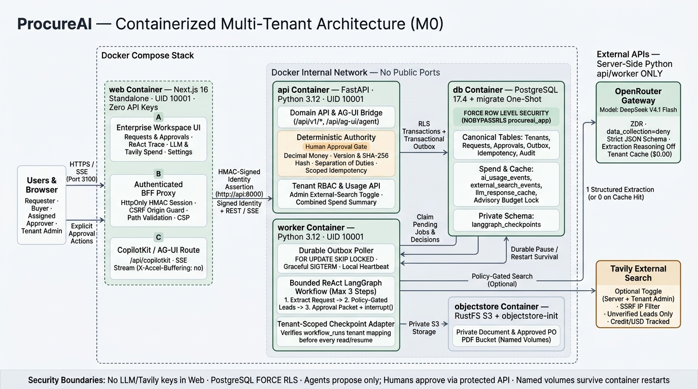
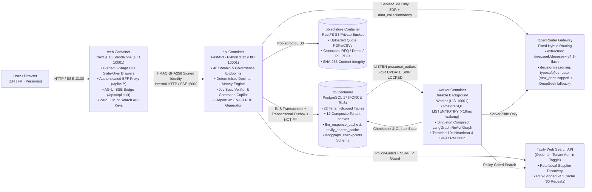

# ProcureAI

> **Turn a purchasing request and supplier quotations into a traceable comparison, an authorized human decision, and a numbered approved Purchase Order PDF — in one multi-tenant bilingual (`EN | FR`) workspace.**



---

## Table of Contents

- [System Architecture](#system-architecture)
- [End-to-End 6-Stage Procurement Flow](#end-to-end-6-stage-procurement-flow)
- [AI Architecture: LangGraph, 6 Specialized Agents & Fixed Hybrid OpenRouter Routing](#ai-architecture-langgraph-6-specialized-agents--fixed-hybrid-openrouter-routing)
- [Workspace Screens & UX Design](#workspace-screens--ux-design)
- [Security, Multi-Tenancy & Reliability Controls](#security-multi-tenancy--reliability-controls)
- [Performance & Cost Optimizations](#performance--cost-optimizations)
- [Database Schema (22 PostgreSQL Tables)](#database-schema-22-postgresql-tables)
- [API Reference Summary](#api-reference-summary)
- [Quick Start (Docker Compose)](#quick-start-docker-compose)
- [Testing, Evaluations & CI](#testing-evaluations--ci)
- [Repository Structure](#repository-structure)
- [Documentation Index](#documentation-index)

---

## System Architecture

ProcureAI runs as a self-contained, non-root **Docker Compose** stack with zero host Node.js or Python installations required. Only the Next.js frontend/BFF (`web` on port `3100`) is exposed to the host; `api`, `worker`, `db`, and `objectstore` communicate exclusively over an internal Docker network.



### Containerized Services (`infra/compose.yaml`)

| Service | Image / Runtime | Port | Role |
| :--- | :--- | :--- | :--- |
| `web` | Node 22 slim (`Next.js 16` standalone, UID `10001`) | `3100` (host) | Enterprise UI, HttpOnly session cookie, HMAC-signed BFF proxy, AG-UI SSE bridge |
| `api` | Python 3.12 slim (`FastAPI` + `uvicorn`, UID `10001`) | `8000` (internal) | Multi-tenant domain API, deterministic pricing/approvals, OpenRouter/Tavily clients, PDF generation |
| `worker` | Python 3.12 slim (`app.worker`, UID `10001`) | internal | Event-driven `LISTEN/NOTIFY` outbox processor & LangGraph ReAct workflow runner |
| `db` | `postgres:17` | `5432` (internal) | Canonical relational store with `FORCE ROW LEVEL SECURITY` (`procureai_app` `NOBYPASSRLS` role) |
| `objectstore` | RustFS (S3-compatible) | `9000` (internal) | Private object bucket for uploaded supplier documents and generated RFQ/Quote/PO PDFs |
| `migrate` | Python 3.12 one-shot (`app.migrate`) | — | Idempotent DDL, 12 composite indexes, `FORCE RLS` policies, LangGraph checkpointer tables, demo seed |
| `objectstore-init` | Python 3.12 one-shot (`app.init_storage`) | — | Ensures private S3 bucket exists before `api` and `worker` start |

---

## End-to-End 6-Stage Procurement Flow

Every purchase request follows a deterministic, human-governed 6-stage lifecycle with **two mandatory human approval checkpoints**. Agents propose only; humans decide via protected domain APIs.

```mermaid
flowchart LR
    S1["Stage 1: Request Draft<br/>• AI Intake or 1-Click Preset<br/>• TND/EUR/USD + City + Specs<br/>• EN/FR PDF Lang + Timbre Fiscal"] --> S2["Stage 2: Suppliers & RFQ<br/>• Live Tavily Web Discovery<br/>• Saved Directory + Select All<br/>• Version-Locked RFQ PDF & Emails"]
    S2 --> S3["Stage 3: Quotations<br/>• Upload PDF/CSV (DeepSeek)<br/>• 4-Scenario Demo Generator<br/>• Slide-Over PDF Preview<br/>• Attributable Revisions (Rev N→N+1)"]
    S3 --> S4["Stage 4: Comparison<br/>• Exact Python Decimal Math<br/>• Eligibility Checked BEFORE Ranking<br/>• Batched Jev Spec Verifier<br/>  (pass / needs_clarification / fail)"]
    S4 -->|Submit Eligible Offer| S5A["Stage 5 · Checkpoint 1/2<br/>Supplier Award Approval<br/>• Separation of Duties<br/>• Currency-Normalized Limits<br/>• SHA-256 Payload Lock"]
    S5A -->|Approved| S6A["Stage 6: PO Draft<br/>• Immutable Commercial Payload<br/>• Requests Checkpoint 2/2"]
    S6A --> S5B["Stage 5 · Checkpoint 2/2<br/>Final PO Release Approval<br/>• Explicit Human Review<br/>• Idempotency-Key Guard"]
    S5B -->|Approved| S6B["Stage 6: Approved PO PDF<br/>• Sequential PO-YYYY-NNNN<br/>• Bilingual EN/FR Official PDF<br/>• SHA-256 Checksum & Issue Log"]
```



### Detailed Capabilities by Stage

1. **Stage 1 — Editable Purchase Request Draft (`RequestVersion`)**
   - Start from natural language (**Create with AI** → background LangGraph ReAct extraction with live SSE updates) or two 1-click ready scenarios: **Tunisia Demo (`Sousse · TND · FR + Timbre Fiscal`)** and **Global Demo (`20 Laptops · USD · EN`)**.
   - Full editability of title, product description, quantity, unit, delivery deadline, budget cap, delivery city/country, mandatory technical specifications, and document language (`EN` or `FR`).
   - Global ISO currency support (`TND` 3-decimal millimes, `EUR`, `USD`, `MAD`, `DZD`, `GBP`, `SAR`, `AED`, `CAD`, `CHF`, `JPY`) plus optional **Tunisian Fiscal Stamp (*Timbre Fiscal* `+1.000 TND`)** computed deterministically in `Decimal`.
   - Collapsible **AI Intake ReAct Trace** panel showing every bounded reasoning step when intake ran via LangGraph.

2. **Stage 2 — Live Supplier Discovery & Bilingual RFQ (*Demande de Prix*)**
   - **Live Web Discovery (Tavily + DeepSeek V4.1 Flash):** Searches real web pages for the requested product and city, extracts verbatim company names, websites, matched products/prices, phone numbers, and emails (never fabricated), and flags every lead as `unverified` until verified by a buyer.
   - **Duplicate-Save Protection & Auto-Selection:** Already-saved suppliers are detected by URL/name and marked `Saved` to prevent duplicate rows; saved directory suppliers auto-select cleanly with a `Select All / Clear` toggle.
   - **Version-Locked EN/FR RFQ PDF & Outreach Emails:** Generates bilingual *Demande de Prix* / *Request for Quotation* PDFs stored in RustFS, opens them in the **Slide-Over PDF Preview Drawer**, creates ready-to-send `mailto:` + clipboard email drafts, and supports optional SMTP dispatch with PDF attachment (`lang`-aware) after explicit human review.
   - **Fast Demo Shortcut:** One-click **Generate Example Quotes** creates up to 4 supplier-grounded, watermarked `[DEMO SIMULATION]` quotations + downloadable PDFs covering realistic procurement edge cases (lowest eligible winner, higher-priced eligible offer, unconfirmed specs needing clarification, and disqualified/over-budget or late-delivery offer).

3. **Stage 3 — Supplier Quotations, Inline PDF Preview & Revision Diffs**
   - **Digital Document Extraction (`pypdf` + DeepSeek V4.1 Flash):** Upload real `.pdf`, `.csv`, or `.txt` quotations; files are stored privately in RustFS with SHA-256 hashes, extracted fields populate a review form (including `offered_specs_text` and verbatim source excerpts), and missing freight/tax stays `Unknown` (never coerced to `0`).
   - **3-Option Guided Empty State & Collapsible Manual Form:** Keeps received quotation cards front-and-center while tucking manual entry behind a clean toggle (which auto-opens on file upload).
   - **Slide-Over PDF Preview & Attributable Human Corrections:** Inspect any quote PDF from any scroll position (`Esc` or backdrop to close), edit price/freight/delivery or apply an attributable **Mandatory-Spec Override** (`pass` / `needs_clarification` / `fail`) with required reason — creating immutable `Rev N → Rev N+1` history diffs displayed directly on each card.

4. **Stage 4 — Deterministic Comparison Matrix + Jev Mandatory-Spec Verifier**
   - **Exact `Decimal` Arithmetic (`services/api/app/domain/comparison.py`):** Computes item subtotal, discount, freight, tax/TVA, optional `Timbre Fiscal`, total quoted cost, and budget headroom (explicitly labeled as headroom, never a fabricated savings claim). Missing freight or tax prevents total calculation (`Incomplete` / `needs_clarification`).
   - **Eligibility Checked Before Ranking:** Any quote violating delivery deadline, budget cap, currency match, mandatory specs, or missing required cost components is disqualified or flagged *before* ranking eligible offers by lowest total.
   - **Single Batched `typesafe/jev-router` Spec Verifier:** Verifies all quotations against all mandatory specifications in **one batched structured JSON call** (`decision` profile, ZDR + `max_price` caps) returning per-spec badges (`✓ pass`, `? needs_clarification`, `✗ fail`) with hover evidence and model route attribution. Clicking **Clarify in Stage 3 →** jumps directly to that quote's inline editor.

5. **Stage 5 — Two-Checkpoint Authorized Human Approvals**
   - **Checkpoint 1 of 2 (`supplier_award`)** & **Checkpoint 2 of 2 (`po_release`):** Enforced strictly by server-side domain APIs (`services/api/app/application/decisions.py`).
   - **Enterprise Governance Rules:**
     - **Separation of Duties:** Requesters cannot approve their own requests (`SELF_APPROVAL_BLOCKED`).
     - **Currency-Normalized Authority Limits:** Approver USD limits are converted deterministically to the request's currency (`TND`, `EUR`, etc.) before authorizing.
     - **Canonical SHA-256 Payload Locking & Optimistic Version Check:** Every approval locks `expected_version` and `expected_payload_hash` so silent post-review tampering returns `STALE_VERSION`.
     - **Scoped Idempotency Keys:** Duplicate clicks or network retries with the same `Idempotency-Key` replay cleanly without double-approving.
   - **Guided UI Guardrails:** Decision buttons (`Approve`, `Request Changes`, `Reject`) stay disabled for unauthorized personas, surfacing a 1-click **Switch to Assigned Approver** button in demo mode, plus a complete **Recorded Approval Decisions** audit trail.

6. **Stage 6 — Numbered Approved PO PDF & External Dispatch**
   - **Prerequisite Guards:** Prevents premature PO drafting before Checkpoint 1 award approval and directs users back to Checkpoint 2 when a PO draft is awaiting final release.
   - **Atomic Sequential PO Numbering:** Issues gap-safe, concurrency-safe tenant-scoped numbers (`PO-YYYY-NNNN`) upon Checkpoint 2 approval.
   - **Bilingual Official PO PDF (*Bon de Commande Officiel*):** Generated with ReportLab using the tenant's customizable company profile, stored in RustFS with a verifiable **SHA-256 checksum**, previewable in the slide-over drawer, downloadable as PDF, and trackable via **Record External Issue**.

---

## AI Architecture: LangGraph, 6 Specialized Agents & Fixed Hybrid OpenRouter Routing

### How Many Agents Are in the System?

ProcureAI runs **1 LangGraph state graph** for asynchronous durable intake (`services/api/app/agents/m0_graph.py`) alongside **5 specialized synchronous/deterministic engines**, all monitored live on the **Agents & Activity** screen (`GET /api/v1/agents/activity`):

| # | Agent / Engine | Execution Mode | Backbone / Model | Authority Boundary |
| :--- | :--- | :--- | :--- | :--- |
| **1** | **Purchase Request Intake Agent (ReAct)** | Async **LangGraph** (`worker` via PostgreSQL `LISTEN/NOTIFY` + `PostgresSaver` checkpoints, max 3 bounded steps) | `deepseek/deepseek-v4.1-flash` (`extraction`) | Proposes editable `RequestVersion` draft + optional policy-gated web leads |
| **2** | **Real Supplier & Contact Discovery Agent** | Sync domain service (`application/sourcing.py`) | `Tavily` (cached 24h) + `deepseek/deepseek-v4.1-flash` | Extracts verbatim web contacts only; saves leads strictly as `unverified` |
| **3** | **Quotation Document Evidence Parser** | Sync domain service (`application/sourcing.py`) | `pypdf` + `deepseek/deepseek-v4.1-flash` | Extracts quoted figures & excerpts into review form; never coerces unknowns to `0` |
| **4** | **Jev Mandatory-Spec Compliance Verifier** | Sync batched verifier (`application/sourcing.py`) | `typesafe/jev-router` (`decision` profile) | Evaluates quotes vs. mandatory specs (`pass` / `needs_clarification` / `fail`); humans can override |
| **5** | **Deterministic Money, Eligibility & PO Engine** | Pure deterministic Python + PostgreSQL | `Python Decimal` + `PostgreSQL 17 FORCE RLS` | **Sole source of truth** for math, `Timbre Fiscal`, ranking, approvals, and `PO-YYYY-NNNN` |
| **6** | **Contextual Command Copilot** | Streaming AG-UI SSE (`application/copilot.py`) | `typesafe/jev-router` (`reasoning` profile) | Explains comparisons, drafts EN/FR clarification emails, prefills Stage 1; **refuses autonomous approvals** |

### Fixed Hybrid OpenRouter Routing (`ADR-0001` & `ADR-0002`)

Every application LLM call routes exclusively through the server-side OpenRouter gateway (`services/api/app/infrastructure/openrouter.py`) enforcing `data_collection: "deny"`, `zdr: true`, strict JSON Schema structured outputs, and atomic daily budget reservations:

| Profile | Configured Model | Policy & Guardrails |
| :--- | :--- | :--- |
| `extraction` | `deepseek/deepseek-v4.1-flash` | `reasoning: { enabled: false }`, strict `json_schema`, tenant-scoped DB cache |
| `decision` | `typesafe/jev-router` | `provider.max_price` capped (`$0.50` prompt / `$1.50` completion per 1M tokens) + ZDR + automatic fallback to `deepseek/deepseek-v4.1-flash` |
| `reasoning` | `typesafe/jev-router` | `provider.max_price` capped + ZDR + automatic fallback to `deepseek/deepseek-v4.1-flash` |

---

## Workspace Screens & UX Design

Built on an enterprise light theme (`#F7F8FA` canvas, `#FFFFFF` surfaces, `#DEE4E9` hairline borders, `#1D2935` slate ink, `#285447` forest-green primary actions, tabular numerals):

- **Procurement Flow (`Overview`):** Clean header with collapsible **`+ New Request`** launcher (AI prompt + 2 quick demos), clickable 4-KPI bar, conditional Pending Approval alert strip, compact request switcher, unified **6-Stage Progress Stepper** with completion checkmarks, and a **1-line Next Recommended Action** guidance bar.
- **Supplier Directory:** Tenant-isolated vendor list, quick inline add bar, **inline email editing** (no browser popups), buyer verification workflow, removal guard, and collapsible **Validated CSV Import** (preview duplicates/errors before confirming).
- **Agents & Activity (`Agents & Activité`):** Live durable worker health card (`LISTEN/NOTIFY` status, heartbeat age, active runs, outbox pending/processing/processed/failed counts), live cards for all 6 agents (backbone, call count, cache hits, avg latency, spend), and a filterable chronological background log with expandable JSON payloads and clickable `PR-XXXX` links.
- **Spend & Evaluations:** Combined 24h OpenRouter + Tavily spend vs. daily cap, KV cache & reasoning token metrics, recent LLM call ledger, and the interactive **AI Evaluation & Safety Scorecard** (`dev` + `held_out` splits + 1-click **Run Live OpenRouter Jev Benchmark**).
- **Settings & Profile:** Editable **Company Profile & PDF Branding** (organization name, default city, base currency, default PDF language), Tenant Admin toggle for external Tavily web search, and a live Tavily search tester.
- **Global Ergonomics:** Persistent **`EN | FR`** language switcher (persisted in `localStorage`), **Slide-Over PDF Preview Drawer** (fixed right overlay accessible from any stage), **Slide-Over Command Copilot Drawer** (non-disruptive overlay with quick prompt chips), **Floating Toast Notifications** (bottom-right with dismiss button and safe FastAPI `422`/object error parsing), and Dev Persona Switcher.

---

## Security, Multi-Tenancy & Reliability Controls

- **PostgreSQL `FORCE ROW LEVEL SECURITY`:** Runtime traffic connects as non-superuser `procureai_app` (`NOBYPASSRLS`). Every tenant-scoped transaction runs `SELECT set_config('app.current_tenant_id', :tid, true)` inside `tenant_session()` (`services/api/app/infrastructure/db.py`), enforced across all tenant tables.
- **Server-Derived Actor Context (HMAC-SHA256):** The Next.js BFF signs HttpOnly session cookies and forwards short-lived HMAC-SHA256 identity assertions to FastAPI (`X-ProcureAI-Identity`, `X-ProcureAI-Signature`). Browser clients cannot spoof tenant IDs, user IDs, or roles.
- **Zero Secret Leakage:** `OPENROUTER_API_KEY`, `TAVILY_API_KEY`, DB credentials, and `PROCUREAI_SESSION_SECRET` never enter `apps/web` client bundles, `NEXT_PUBLIC_*`, or Docker build layers. Automated CI checks fail if any secret pattern appears in Git-tracked files or `.next/static`.
- **Prompt-Injection & SSRF Defense:** Untrusted document text and web snippets are explicitly wrapped in untrusted-content boundaries before extraction; Tavily URLs pass SSRF IP/private-network checks; PDFs stream with `X-Content-Type-Options: nosniff` and `X-Frame-Options: SAMEORIGIN`.
- **Transactional Outbox & Atomic Budget Governance:** Outbox dispatches commit inside the same DB transaction as state changes and emit `pg_notify('procureai_outbox', ...)`. Combined 24h LLM + Tavily spend reservations synchronize via `pg_advisory_xact_lock` per tenant.

---

## Performance & Cost Optimizations

- **Tenant-Isolated Response Caches (`$0.00` Repeats):** Both `llm_response_cache` (SHA-256 keyed by tenant, profile, model, prompt, schema) and `tavily_search_cache` (SHA-256 keyed by tenant, normalized query, depth, max results, 24h TTL) eliminate duplicate API costs while strictly obeying PostgreSQL RLS.
- **Event-Driven Worker (`PostgreSQL LISTEN/NOTIFY`):** Replaced 1-second busy polling with an async `LISTEN procureai_outbox` + `select.select` loop (`<10 ms` wakeup latency, `~0.12%` idle CPU, throttled 10s heartbeat).
- **Singleton Compiled LangGraph & Connection Pooling:** Compiled LangGraph workflow and `httpx.Client` / `boto3` S3 clients are pooled and reused across requests instead of recreated per call.
- **12 Composite Multi-Tenant DB Indexes & Lean Queries:** Composite `(tenant_id, ...)` indexes accelerate all hot paths; `GET /api/v1/runs` uses a single `LEFT JOIN` instead of `N+1` queries; `GET /api/v1/usage/summary` aggregates in a single `FILTER` SQL pass; SSE streaming releases DB connections between polls.

---

## Database Schema (22 PostgreSQL Tables)

| Domain | Tables |
| :--- | :--- |
| **Identity & Multi-Tenancy** | `tenants`, `users`, `memberships` |
| **Procurement Lifecycle** | `purchase_requests`, `request_versions`, `suppliers`, `rfqs`, `quotations`, `comparisons`, `purchase_orders` |
| **Approvals & Reliability** | `approval_requests`, `approval_decisions`, `outbox_events`, `idempotency_records`, `audit_events` |
| **LangGraph & Streaming** | `workflow_runs`, `run_events` *(+ dedicated `langgraph_checkpoints` schema)* |
| **AI & Search Governance** | `ai_usage_reservations`, `ai_usage_events`, `external_search_events`, `llm_response_cache`, `tavily_search_cache` |

---

## API Reference Summary

All `/api/v1/*` routes are proxied through the authenticated Next.js BFF (`apps/web/src/app/api/v1/[...path]/route.ts`) and require a valid signed actor session:

- **Health & Session:** `GET /health/live`, `GET /health/ready`, `GET /api/v1/me`, `GET/PATCH /api/v1/tenant/settings`
- **Workspace & Observability:** `GET /api/v1/overview/summary`, `GET /api/v1/agents/activity`, `GET /api/v1/usage/summary`, `GET /api/v1/evals/summary`, `POST /api/v1/evals/run`
- **Requests & Intake:** `POST /api/v1/runs/intake`, `GET /api/v1/runs`, `GET /api/v1/runs/{run_id}`, `GET /api/v1/runs/{run_id}/stream` (SSE), `POST /api/v1/requests/preset-sousse-tnd`, `POST /api/v1/requests/demo-20-laptops`, `GET /api/v1/requests/{id}/workspace`, `PATCH /api/v1/requests/{id}`
- **Suppliers & Discovery:** `GET/POST /api/v1/suppliers`, `PATCH/DELETE /api/v1/suppliers/{id}`, `POST /api/v1/suppliers/{id}/verify`, `POST /api/v1/suppliers/import-csv`, `POST /api/v1/suppliers/search-extract`, `POST /api/v1/suppliers/discover-external`
- **RFQs & Quotations:** `POST /api/v1/requests/{id}/rfqs`, `GET /api/v1/rfqs/{id}/pdf`, `GET /api/v1/rfqs/{id}/emails`, `POST /api/v1/rfqs/{id}/send-emails`, `POST /api/v1/rfqs/{id}/distribute`, `POST /api/v1/requests/{id}/quotations/extract-upload`, `POST /api/v1/requests/{id}/quotations`, `POST /api/v1/requests/{id}/quotations/seed-sample`, `GET /api/v1/quotations/{id}/pdf`, `PATCH /api/v1/quotations/{id}`
- **Comparison, Approvals & PO:** `POST /api/v1/requests/{id}/compare`, `POST /api/v1/requests/{id}/award-review`, `POST /api/v1/decisions/{id}/approve`, `POST /api/v1/decisions/{id}/reject`, `POST /api/v1/decisions/{id}/request-changes`, `POST /api/v1/requests/{id}/po-draft`, `GET /api/v1/purchase-orders/{id}/pdf`, `POST /api/v1/purchase-orders/{id}/record-issue`
- **Command Copilot:** `POST /api/copilotkit` → `POST /api/ag-ui/agent` (AG-UI SSE)

---

## Quick Start (Docker Compose)

### 1. Configure Local Environment

```bash
cp .env.example .env
```

Edit `.env` (gitignored & dockerignored — **never commit `.env`**) and populate:
- `PROCUREAI_SESSION_SECRET` (32+ random characters)
- `POSTGRES_PASSWORD`, `POSTGRES_APP_PASSWORD`, `OBJECTSTORE_ROOT_PASSWORD`
- `OPENROUTER_API_KEY` (required for live intake extraction, Jev spec verification, and Copilot)
- `TAVILY_API_KEY` (optional; enables live supplier web discovery)
- Optional SMTP vars (`PROCUREAI_SMTP_HOST`, `PROCUREAI_SMTP_PORT`, etc.) if you want direct SMTP RFQ sending

### 2. Build & Launch the Complete Stack

```bash
docker compose --env-file .env -f infra/compose.yaml up -d --build
```

Open **http://localhost:3100** (configurable via `WEB_PORT` in `.env`).

### 3. Built-In Showcase Personas (Dev Switcher)

The seeded workspace includes two completely isolated tenants (enforced by PostgreSQL `FORCE RLS`) so you can test separation of duties and cross-tenant isolation immediately from the top-bar **Act as** switcher:
- **Buyer / Requester** (creates requests, runs supplier searches, compares quotes, submits awards — blocked from self-approving)
- **Assigned Approver / Tenant Admin** (approves Checkpoint 1 Supplier Award & Checkpoint 2 Final PO Release, edits company branding & external search policy)
- **Second Tenant Persona** (verifies zero cross-tenant data visibility across requests, suppliers, quotes, checkpoints, caches, and logs)

---

## Testing, Evaluations & CI

```bash
# 1. Automated Safety & Invariant Suite (11 tests: RLS, Decimal money, idempotency,
#    Tavily cache, Jev verifier, Copilot guardrails, Timbre Fiscal & currency limits)
docker compose --env-file .env -f infra/compose.yaml exec -T api pytest -q

# 2. Offline Evaluation Suite (dev + held-out deterministic accuracy & injection safety)
docker compose --env-file .env -f infra/compose.yaml exec -T api python -m app.evals

# 3. Optional Live OpenRouter Jev Router Benchmark (adversarial prompt injection + FR Devis)
docker compose --env-file .env -f infra/compose.yaml exec -T api python -m app.evals --live
```

GitHub Actions CI (`.github/workflows/ci.yml`) runs automatically on push/PR to validate:
1. Secret-leak scan across tracked files (blocking real API keys)
2. `web` Next.js TypeScript & production build check + client bundle secret scan
3. `api` + `worker` Docker image build, PostgreSQL 17 migration + `FORCE RLS` bootstrap, `pytest -q`, and offline `python -m app.evals`

---

## Repository Structure

```text
.
├── apps/web/                         # Next.js 16 App Router (TypeScript + Tailwind BFF & UI)
│   └── src/
│       ├── app/api/                  # Authenticated BFF proxy, session cookie, AG-UI bridge, health
│       ├── components/
│       │   ├── ProcureWorkspace.tsx  # Main workspace shell, KPIs, Suppliers, Usage/Evals, Settings
│       │   ├── CaseFlowView.tsx      # Guided 6-stage procurement flow with next-step hints & guards
│       │   ├── AgentsActivityView.tsx# Live 6-agent roster, worker health & background event log
│       │   ├── PdfPreviewDrawer.tsx  # Fixed right-side inline PDF preview drawer
│       │   ├── CopilotDrawer.tsx     # Fixed right-side Command Copilot drawer (AG-UI SSE)
│       │   └── types.ts              # Shared TypeScript domain contracts
│       └── lib/
│           ├── i18n.ts               # Complete EN | FR localization dictionary
│           ├── errors.ts             # Safe FastAPI error parser (422/object) & clipboard helper
│           └── session.ts            # HMAC-SHA256 BFF identity signing
├── services/api/                     # FastAPI Domain API, LangGraph Worker & Evaluations
│   ├── app/
│   │   ├── agents/m0_graph.py        # Bounded ReAct LangGraph workflow & tenant-scoped PG checkpointer
│   │   ├── api/procurement.py        # Core procurement domain REST routes
│   │   ├── application/              # Sourcing/Jev verifier, approval decisions, Command Copilot
│   │   ├── documents/pdf_generator.py# Bilingual EN/FR ReportLab PDF generators (RFQ / Quote / PO)
│   │   ├── domain/                   # 22 SQLAlchemy models, Decimal money, comparison engine
│   │   ├── infrastructure/           # RLS DB sessions, OpenRouter gateway, Tavily, RustFS S3, auth
│   │   ├── evals.py                  # CLI & API evaluation corpus (dev + held-out + --live)
│   │   ├── main.py                   # FastAPI entrypoint, overview, agents/activity, usage, AG-UI
│   │   ├── migrate.py                # Idempotent schema, 12 composite indexes & FORCE RLS setup
│   │   └── worker.py                 # PostgreSQL LISTEN/NOTIFY durable outbox worker
│   └── tests/test_m0_invariants.py   # Pytest security, RLS, money, Jev & workflow invariant tests
├── infra/                            # Multi-stage Dockerfiles, Compose stack & DB role bootstrap
├── .github/workflows/ci.yml          # GitHub Actions CI (secret scan, web build, pytest, evals)
├── docs/                             # ADRs, Security Audit, Docker guide & architecture diagram
├── design/                           # Reference enterprise UI mockups & prompt specs
├── .env.example                      # Secret-free configuration template
├── AGENTS.md                         # Workspace rules & non-negotiable guardrails
├── GLOSSARY.md                       # Canonical procurement domain vocabulary
└── PROCUREAI_MASTER_PLAN.md          # Complete product & engineering specification
```

---

## Documentation Index

- [Architecture Decision Record 0001 — OpenRouter + DeepSeek V4.1 Flash](docs/adr/0001-openrouter-deepseek-v4-flash.md)
- [Architecture Decision Record 0002 — Fixed Hybrid Jev Router](docs/adr/0002-openrouter-jev-hybrid-routing.md)
- [Docker Packaging & Production Guide](docs/DOCKER.md)
- [Security Audit & Remediations](docs/SECURITY_AUDIT.md)
- [Stack Compatibility Notes](docs/STACK_COMPATIBILITY.md)
- [Skills Manifest](docs/SKILLS_MANIFEST.md)
- [Domain Glossary](GLOSSARY.md)
- [Master Product & Engineering Plan](PROCUREAI_MASTER_PLAN.md)
